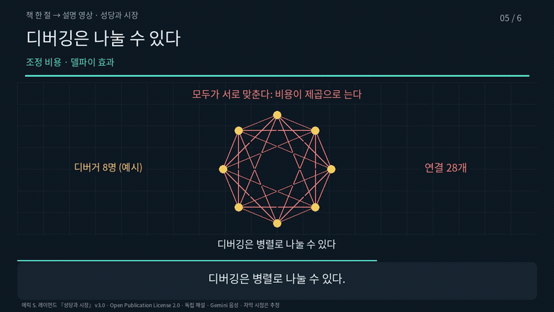
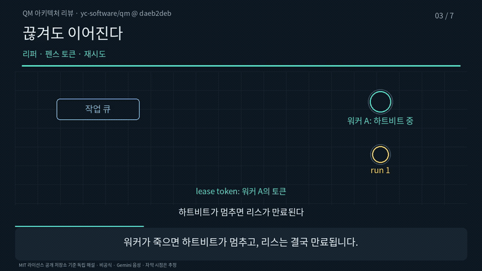
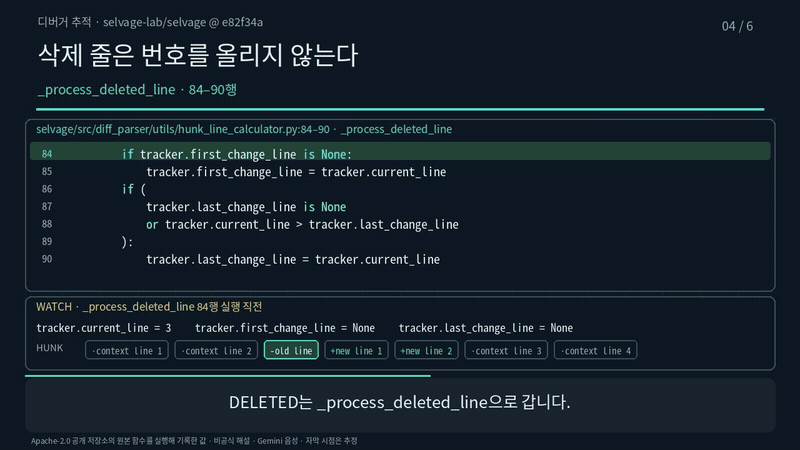

# source-to-explainer-video

[English](README.md) | 한국어

책의 한 절, 논문, 코드 변경, 저장소 하나를 나레이션이 있는 설명 영상으로 만드는 에이전트 스킬입니다.
Claude Code, Codex처럼 스킬을 읽는 코딩 에이전트에서 씁니다.

결과물은 MP4 영상과 SRT 자막, 원본 대조 기록, 그리고 같은 영상을 다시 만들 수 있는 소스 패키지입니다.

## 의도

AI 덕분에 코드와 글은 빨리 만들어집니다. 하지만 그것을 검토하고 이해하는 일은 여전히 사람의 몫이고,
오히려 늘었습니다([Lee 외 2025](https://doi.org/10.1145/3706598.3713778), [METR 2025](https://metr.org/blog/2025-07-10-early-2025-ai-experienced-os-dev-study/)). 집중력과 작업기억은 유한합니다([Cowan 2001](https://doi.org/10.1017/s0140525x01003922)).

이 스킬은 본격적으로 읽기 전에 귀와 눈으로 큰 그림을 먼저 잡는 도구입니다([Mayer 2014](https://www.cambridge.org/core/books/cambridge-handbook-of-multimedia-learning/principles-for-managing-essential-processing-in-multimedia-learning-segmenting-pretraining-and-modality-principles/DD24C2F48B9B1277CE59F78276110258)).
코드 리뷰와 PR 리뷰 전에, 책을 읽기 전이나 읽고 나서 갈무리할 때 씁니다. 영상을 보고 나면
내가 무엇을 모르는지, 무엇을 직접 확인해야 하는지가 먼저 보입니다.

영상이 이해를 대신하지는 않습니다. 영상은 기존 학습을 대체할 때보다 보조할 때 효과가 큽니다([Noetel 외 2021](https://doi.org/10.3102/0034654321990713)).
매끄러운 설명은 배웠다는 느낌만 키우기도 합니다([Carpenter 외 2013](https://doi.org/10.3758/s13423-013-0442-z)). 그래서 확인하지 못한 것은
영상과 검사 기록에 따로 남깁니다.

## 예제

세 편 모두 공개 원본으로 만들었고, 한국어판과 영어판이 따로 있습니다. GIF에는 소리가 없으니 MP4로 들어 보세요.

### 책 한 절 → 개념 영상

『성당과 시장』(v3.0)의 '일찍 내고, 자주 내라' 절을 여섯 장면으로 풀었습니다.



[한국어 3:04](example-concept/preview/ko.mp4) · [영어 3:07](example-concept/preview/en.mp4) · [자막](example-concept/preview/ko.srt) · [만든 과정](example-concept/README.ko.md)

### 저장소 → 아키텍처 리뷰

[QM](https://github.com/yc-software/qm)(커밋 `daeb2deb`)에서 요청 하나가 작업 큐, 리스, 리퍼,
세션 테이프, 하네스, 스코프를 지나가는 길을 일곱 장면으로 따라갑니다.
마지막 장면은 직접 돌린 테스트 결과입니다.



[한국어 3:56](example-architecture/preview/ko.mp4) · [영어 3:54](example-architecture/preview/en.mp4) · [자막](example-architecture/preview/ko.srt) · [만든 과정](example-architecture/README.ko.md)

### 함수 → 디버거 추적

[selvage](https://github.com/selvage-lab/selvage)(커밋 `e82f34a`)의 `calculate_actual_change_lines`를
저장소 테스트 입력으로 실행하고, 줄마다 기록한 변수 값을 그대로 보여 줍니다.



[한국어 2:51](example-debugger/preview/ko.mp4) · [영어 2:45](example-debugger/preview/en.mp4) · [자막](example-debugger/preview/ko.srt) · [만든 과정](example-debugger/README.ko.md)

18초짜리 최소 예제도 있습니다: [가상 재고 함수의 코드 줄 추적](example-code-trace/README.ko.md).

## 선택: 3D 에셋 키트

[하이브리드 3D 키트](assets/hybrid-3d/README.md)에 사람·집/소품·사자·여우·늑대,
샷별 고정 카메라와 불/연기 PNG 4종이 들어 있습니다. 다른 로컬 폴더 없이 쓸 수 있습니다.
코드는 MIT, Unity 텍스처는 **CC0-1.0**으로 구분했습니다.
[출처·변환·해시·재배포 범위](THIRD_PARTY_NOTICES.md)를 함께 보세요.

[무음 12초 데모와 재현 방법](example-3d/README.md) ·
[MP4](example-3d/preview/kit.mp4) · [실제 영상 추출 프레임](example-3d/preview/contact.jpg).
에셋 동작 확인용이며, 내레이션 영상이나 비공개 책 영상의 공개본은 아닙니다.
기존 2D 기본값과 음성 공급자 선택은 바꾸지 않습니다.

## 설치

```bash
# Claude Code
git clone https://github.com/denim-claw/source-to-explainer-video ~/.claude/skills/source-to-explainer-video

# ~/.agents/skills를 읽는 에이전트 (Codex 등)
git clone https://github.com/denim-claw/source-to-explainer-video ~/.agents/skills/source-to-explainer-video
```

스킬 폴더에서 Python 환경과 글꼴을 준비합니다.

```bash
python3 -m venv .venv && .venv/bin/pip install -r requirements.txt
PATH=".venv/bin:$PATH" bash example/assets/fetch-font.sh        # 본문 글꼴 (OFL)
PATH=".venv/bin:$PATH" bash example/assets/fetch-font.sh mono   # 코드 글꼴 (OFL)
```

필요한 도구:

- Python 3.11 이상, `ffmpeg`, `ffprobe`
- 음성: 기본 Edge TTS. Gemini를 명시적으로 선택할 때만 `GEMINI_API_KEY` 필요
- 선택: 음성 받아쓰기 검사용 `whisper-cli`와 모델 (`WHISPER_MODEL`)

## 사용법

에이전트에게 원본과 원하는 설명을 말합니다.

```text
『성당과 시장』의 '일찍 내고, 자주 내라' 절을 3분 안팎의 설명 영상으로 만들어 줘
이 PR이 바꾼 동작을 영상으로 설명해 줘
selvage의 calculate_actual_change_lines를 디버거처럼 따라가는 영상을 한국어, 영어로 만들어 줘
```

에이전트는 이 순서로 작업합니다.

1. **원본 고정**: 판본, 범위, 커밋, 파일 해시를 기록합니다.
2. **장면 계획**: 장면마다 주장 하나, 그림의 변화 하나를 정합니다.
3. **음성**: 선택한 공급자(기본 Edge)로 음성을 만들고, 실제 길이로 시간표와 자막을 짭니다.
4. **렌더링**: Pillow로 프레임을 그리고 FFmpeg로 1280×720 H.264 영상을 만듭니다.
5. **검사**: 설명이 원본과 맞는지 대조하고, 완성된 MP4의 프레임 수·디코딩·글자 겹침·음량을 따로 검사합니다.
6. **패키지**: 영상, 자막, 검사 기록, 다시 만들 수 있는 소스를 묶습니다.

영상을 웹에 올리는 일은 따로 요청할 때만 합니다.

## 설명 방식

| 원본 | 방식 | 참고 문서 |
|---|---|---|
| 책, 논문, 명세 | 장면마다 주장 하나와 그림의 변화 하나 | [SKILL.md](SKILL.md) |
| 코드 변경, 저장소 구조 | 동작 흐름을 그림으로 보여 줌. 코드를 한 줄씩 읽지 않음 | [from-code-review.md](references/from-code-review.md) |
| 함수의 실행 순서와 값 | 코드 줄 강조, 또는 실제 실행을 기록한 디버거 추적 | [code-trace.md](references/code-trace.md) |

## 음성 선택

기본은 Edge TTS입니다. API 키나 별도 API 요금이 들지 않지만 음성이 덜 자연스러울 수 있고, 온라인 서비스에 의존합니다. 빌더가 이 차이를 알린 뒤, 자연스러운 음성을 원한다고 명시하지 않으면 Edge로 진행합니다. Gemini를 선택하려면 `TTS_PROVIDER=gemini`와 `GEMINI_API_KEY`를 설정하세요. 음성 공급자를 묵시적으로 바꾸지 않습니다. `example/requirements-edge.txt`로 설치하고, 명령과 장면별 음성 기록·서비스 제한은 [TTS 가이드](references/tts.md)를 보세요.

## 원본 라이선스

설명 영상을 만들어도 원본을 다시 배포할 권리는 생기지 않습니다. 공개할 영상에는 이런 원본을 씁니다.

- 수정과 배포를 허락한 글: 퍼블릭 도메인, CC BY, Open Publication License
- MIT, Apache-2.0 같은 허용 라이선스의 공개 저장소. 커밋을 고정하고 라이선스를 밝힙니다.
- 직접 쓴 자료

시판 도서, 유료 강의, 다른 사람의 SNS 글은 짧은 인용까지만 씁니다.
개인 학습용으로 만든 영상은 공개하지 않습니다.

## 예제 다시 만들기

스킬 폴더에서 실행합니다.

```bash
# 음성 없이 파이프라인만 확인 (임시 음성은 말소리 없는 배경음)
cd example
bash make_demo_audio.sh
../.venv/bin/python design.py
../.venv/bin/python prepare.py
../.venv/bin/python render.py --samples
../.venv/bin/python render.py --determinism
../.venv/bin/python render.py          # master.mp4
../.venv/bin/python qa.py
../.venv/bin/python fidelity.py
../.venv/bin/python package.py
cd ..

# 공개 원본 예제 세 편 (한국어와 영어)
export TTS_PROVIDER=gemini GEMINI_API_KEY=...
.venv/bin/python example-concept/pipeline.py
.venv/bin/python example-architecture/pipeline.py --lang ko
.venv/bin/python example-debugger/pipeline.py
```

**기본 음성은 Edge TTS입니다.** API 키나 별도 API 요금이 들지 않지만 억양이 덜 자연스러울
수 있고 온라인 서비스에 의존합니다. 빌더가 이 점을 알리고, 자연스러운 음성 선호가 명시되지
않으면 Edge로 진행합니다. Gemini 음성을 원하면 `TTS_PROVIDER=gemini`와
`GEMINI_API_KEY`를 설정하세요. 공급자를 몰래 바꾸지 않습니다. `example/requirements-edge.txt`로
설치하고, 단독 실행·MP3/WAV 보존·서비스 제한은 [TTS 가이드](references/tts.md)를 보세요.

음성은 장면마다 만들며 설정이 맞는 파일은 재사용합니다. Gemini는 새 합성이 필요할 때만 API 키를
읽습니다. 대본·모델·목소리가 같은 음성이 `audio-cache/`에 있으면 다시 만들지 않습니다.
`WHISPER_MODEL`에 whisper.cpp 모델 경로를 넣으면 장면별 음성을 받아 적어 대본과 비교합니다.

## 구성

```text
SKILL.md                     작업 순서, 결과물 기준, 흔한 실수
references/
  pipeline.md                명령 순서와 지켜야 할 조건
  renderer-notes.md          화면 배치, 애니메이션, 장면 전환
  tts.md                     장면별 음성 생성과 재사용, 자막
  video-qa.md                완성 파일 검사 목록
  source-fidelity.md         원본 항목·조건·예외 대조
  from-code-review.md        코드 변경과 아키텍처 리뷰
  code-trace.md              코드 줄 추적과 디버거 추적
  asd-ste-80.md              영어 문장 규칙
  writing-ko.md              한국어 문장 규칙
example/                     공통 파이프라인과 3장면 기본 예제
example-concept/             『성당과 시장』 개념 영상
example-architecture/        QM 아키텍처 리뷰
example-debugger/            selvage 디버거 추적
example-code-trace/          코드 줄 추적 최소 예제
```

## 원칙

- 원본을 먼저 고정하고, 비슷한 자료로 바꾸지 않습니다.
- 한 장면에는 주장 하나, 그림의 변화 하나만 둡니다.
- 비유로 그린 좌표나 개수는 비유라고 표시합니다.
- 원본 대조와 영상 파일 검사는 따로 합니다. 잘 재생된다고 설명이 맞는 것은 아닙니다.
- 하지 않은 검사는 하지 않았다고 기록합니다.

## 라이선스

스킬 문서와 예제 코드는 [MIT](LICENSE)입니다. 글꼴은 저장소에 넣지 않고 따로 받습니다([글꼴 안내](example/assets/README.md)).

예제 원본의 권리는 원저작자에게 있습니다. 『성당과 시장』은 Eric S. Raymond의 글로 Open Publication License 2.0,
QM은 MIT, selvage는 Apache-2.0입니다. 세 예제 모두 비공식 해설입니다.
