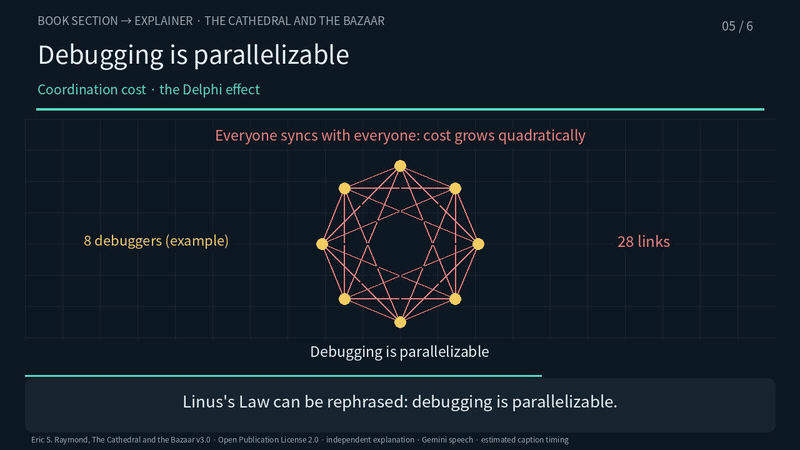
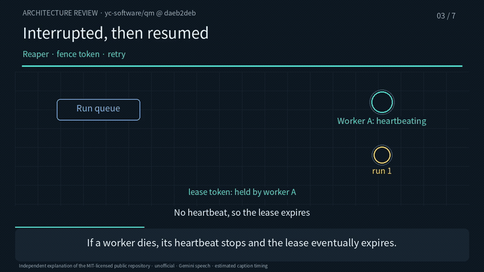
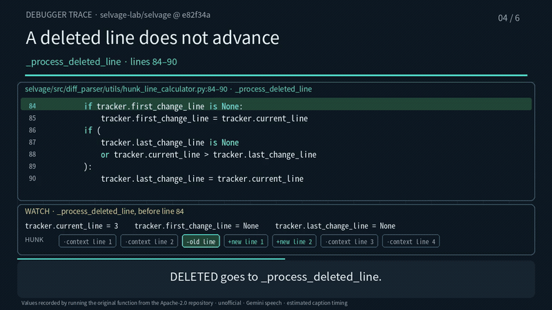

# source-to-explainer-video

English | [한국어](README.ko.md)

An agent skill that turns one source — a book section, a paper, a code change or a repository — into a narrated explainer video.
It works with coding agents that load skills, such as Claude Code and Codex.

You get an MP4 with SRT captions, a source-fidelity record and a source package that rebuilds the same video.

## Why

AI makes code and text fast to produce. Reviewing and understanding them is still human work, and there
is more of it ([Lee et al. 2025](https://doi.org/10.1145/3706598.3713778), [METR 2025](https://metr.org/blog/2025-07-10-early-2025-ai-experienced-os-dev-study/)). Attention and working memory are limited ([Cowan 2001](https://doi.org/10.1017/s0140525x01003922)).

This skill gives you the big picture by ear and eye before you read closely ([Mayer 2014](https://www.cambridge.org/core/books/cambridge-handbook-of-multimedia-learning/principles-for-managing-essential-processing-in-multimedia-learning-segmenting-pretraining-and-modality-principles/DD24C2F48B9B1277CE59F78276110258)). Use it
before a code or PR review, and before reading a book or after it to consolidate. After the video you can see
what you do not know yet and what you must check yourself.

The video does not replace understanding. Video helps more when it supplements study than when it replaces it
([Noetel et al. 2021](https://doi.org/10.3102/0034654321990713)). A smooth explanation can raise the feeling of learning without the learning
([Carpenter et al. 2013](https://doi.org/10.3758/s13423-013-0442-z)). So what was not checked is recorded separately, in the video and in the check records.

## Examples

All three are built from public sources, in Korean and in English. The GIFs are silent; play the MP4s for sound.

### Book section → concept video

The "Release Early, Release Often" section of *The Cathedral and the Bazaar* (v3.0), in six scenes.



[English 3:07](example-concept/preview/en.mp4) · [Korean 3:04](example-concept/preview/ko.mp4) · [captions](example-concept/preview/en.srt) · [how it was made](example-concept/README.md)

### Repository → architecture review

One request through [QM](https://github.com/yc-software/qm) at `daeb2deb`: run queue, lease, reaper,
session tape, harness and scope, in seven scenes. The last scene shows the tests that were actually run.



[English 3:54](example-architecture/preview/en.mp4) · [Korean 3:56](example-architecture/preview/ko.mp4) · [captions](example-architecture/preview/en.srt) · [how it was made](example-architecture/README.md)

### Function → debugger trace

`calculate_actual_change_lines` from [selvage](https://github.com/selvage-lab/selvage) at `e82f34a`,
run on the repository's own test input. Every value on screen was recorded at that line.



[English 2:45](example-debugger/preview/en.mp4) · [Korean 2:51](example-debugger/preview/ko.mp4) · [captions](example-debugger/preview/en.srt) · [how it was made](example-debugger/README.md)

There is also an 18-second minimal example: [a code-line trace of a fictional inventory function](example-code-trace/README.md).

## Optional 3D asset kit

A portable [hybrid-3D kit](assets/hybrid-3d/README.md) now includes procedural people,
house/sets, lion/fox/wolf, fixed-shot camera fitting and four fire/smoke PNG atlases.
Code is MIT; the Unity textures are **CC0-1.0**, not MIT. Sources, transformations,
SHA256s and legal text are bundled; see [rights/limits](THIRD_PARTY_NOTICES.md).

[Silent 12-second demo and rebuild instructions](example-3d/README.md) ·
[MP4](example-3d/preview/kit.mp4) · [contact sheet](example-3d/preview/contact.jpg).
This is an asset smoke test, not a narrated explainer or a private book upload.
3D remains optional; the default concept renderer and TTS choice do not change.

### Native Blender hybrid workflow

The [3D-only production/review playbook](references/3d-hybrid-production-review.md)
uses concrete actor/action scenes for events and direct-label animated diagrams for
abstract relations. It adds a narrated pilot, per-utterance semantic contracts,
native preflight and independent encoded-master/phone-size review. Do not mistake
static coverage or a valid codec for verified action, meaning or listening.

Read [narrative staging](references/narrative-3d.md) and
[3D quality gates](references/3d-mode-quality.md). Reusable native source assets live
in the separate [Blender asset repository](https://github.com/denim-claw/prince-core-blender-assets).
Private chapter text, speech, video and uncleared stock models are not included.
This is an optional 3D extension, not a change to the 2D or speech-provider defaults.

## Installation

```bash
# Claude Code
git clone https://github.com/denim-claw/source-to-explainer-video ~/.claude/skills/source-to-explainer-video

# Agents that read ~/.agents/skills (Codex and others)
git clone https://github.com/denim-claw/source-to-explainer-video ~/.agents/skills/source-to-explainer-video
```

In the skill folder, set up Python and the fonts:

```bash
python3 -m venv .venv && .venv/bin/pip install -r requirements.txt
PATH=".venv/bin:$PATH" bash example/assets/fetch-font.sh        # text font (OFL)
PATH=".venv/bin:$PATH" bash example/assets/fetch-font.sh mono   # code font (OFL)
```

Requirements:

- Python 3.11+, `ffmpeg`, `ffprobe`
- Narration: Edge TTS by default; `GEMINI_API_KEY` only when Gemini is explicitly selected
- Optional: `whisper-cli` and a model (`WHISPER_MODEL`) to transcribe the speech and compare it with the script

## Usage

Tell your agent the source and what you want explained:

```text
Make a three-minute explainer of the "Release Early, Release Often" section of The Cathedral and the Bazaar
Explain the behaviour this PR changes as a video
Walk through selvage's calculate_actual_change_lines like a debugger, in Korean and English
```

The agent then works in this order:

1. **Pin the source**: edition, range, commit and file hashes.
2. **Plan scenes**: one claim and one visual change per scene.
3. **Speech**: the selected provider (Edge by default); timeline and captions follow measured audio lengths.
4. **Render**: Pillow draws the frames and FFmpeg encodes 1280×720 H.264.
5. **Check**: the explanation is compared with the source, and the encoded MP4 is checked separately for frame count, decoding, text overlap and audio level.
6. **Package**: the video, captions, check records and the rebuildable source.

Nothing is uploaded or published unless you ask for it separately.

## Explanation styles

| Source | Style | Reference |
|---|---|---|
| Book, paper, specification | one claim and one visual change per scene | [SKILL.md](SKILL.md) |
| Code change, repository structure | behaviour drawn as paths, not read line by line | [from-code-review.md](references/from-code-review.md) |
| A function's order of execution and values | source-line highlights, or a recorded debugger trace | [code-trace.md](references/code-trace.md) |

## Speech provider

Edge TTS is the default: no API key or separate API charge, but the voice may sound less
natural and relies on an online service. The builder announces the trade-off and proceeds
with Edge unless a preference for natural narration is explicit. For Gemini, set
`TTS_PROVIDER=gemini` and configure `GEMINI_API_KEY`; providers are never switched silently.
Install `example/requirements-edge.txt`. See [the TTS guide](references/tts.md) for commands,
per-scene audio provenance and service limitations.

## Source licensing

Making an explainer does not give you the right to redistribute its source. For videos you publish, use:

- Text whose licence allows changes and redistribution: public domain, CC BY, Open Publication License
- Public repositories under permissive licences such as MIT or Apache-2.0, pinned to a commit with the licence stated
- Material you wrote yourself

Quote commercial books, paid courses and other people's social posts only briefly.
Keep videos made for private study private.

## Rebuilding the examples

Run from the skill folder:

```bash
# Pipeline check without speech (the temporary audio is a tone bed, not a voice)
cd example
bash make_demo_audio.sh
../.venv/bin/python design.py
../.venv/bin/python prepare.py
../.venv/bin/python render.py --samples
../.venv/bin/python render.py --determinism
../.venv/bin/python render.py          # master.mp4
../.venv/bin/python qa.py
../.venv/bin/python fidelity.py
../.venv/bin/python package.py
cd ..

# The three public-source examples (Korean and English)
export TTS_PROVIDER=gemini GEMINI_API_KEY=...
.venv/bin/python example-concept/pipeline.py
.venv/bin/python example-architecture/pipeline.py --lang en
.venv/bin/python example-debugger/pipeline.py
```

**Default speech: Edge TTS.** It needs no API key or separate API charge, but can sound less
natural and relies on an online service. The builder announces this and proceeds with Edge
unless a natural-voice preference is explicit. For more natural Gemini TTS, set
`TTS_PROVIDER=gemini` and configure `GEMINI_API_KEY`; the builder never switches providers
silently. Install `example/requirements-edge.txt`; see [the TTS guide](references/tts.md)
for standalone commands, preserved MP3/WAV provenance and service limitations.

Speech is synthesised per scene. Matching audio is reused; Gemini does not read its API key
until genuinely new synthesis is needed. When `audio-cache/` already holds speech for the
same script, model and voice, it is reused. Set `WHISPER_MODEL` to a whisper.cpp model to
transcribe each scene and compare it with the script.

## What's inside

```text
SKILL.md                     workflow, deliverable rules, common mistakes
references/
  pipeline.md                command order and invariants
  renderer-notes.md          layout, animation and scene transitions
  tts.md                     per-scene speech, reuse and captions
  video-qa.md                checks on the encoded file
  source-fidelity.md         item, condition and exception checks against the source
  from-code-review.md        code changes and architecture reviews
  code-trace.md              source-line and debugger traces
  asd-ste-80.md              English sentence rules
  writing-ko.md              Korean sentence rules
example/                     shared pipeline and a three-scene base example
example-concept/             The Cathedral and the Bazaar concept video
example-architecture/        QM architecture review
example-debugger/            selvage debugger trace
example-code-trace/          minimal code-line trace
```

## Principles

- Pin the source first. Do not swap in similar material.
- One claim and one visual change per scene.
- Mark invented positions and counts as metaphors.
- Check the source fidelity and the video file separately. A video that plays well can still be wrong.
- Record the checks that were not done.

## License

The skill documents and example code are [MIT](LICENSE). Fonts are fetched separately, not committed ([font notes](example/assets/README.md)).

Rights to the example sources stay with their authors: *The Cathedral and the Bazaar* by Eric S. Raymond is under
the Open Publication License 2.0, QM is MIT and selvage is Apache-2.0. All three examples are unofficial explanations.
